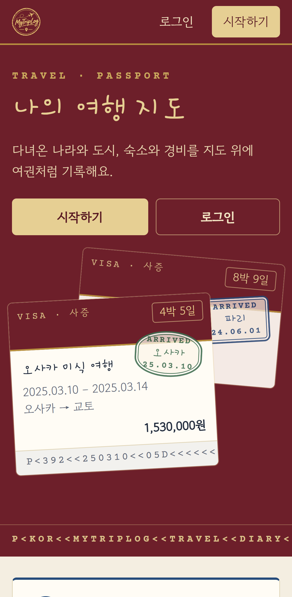
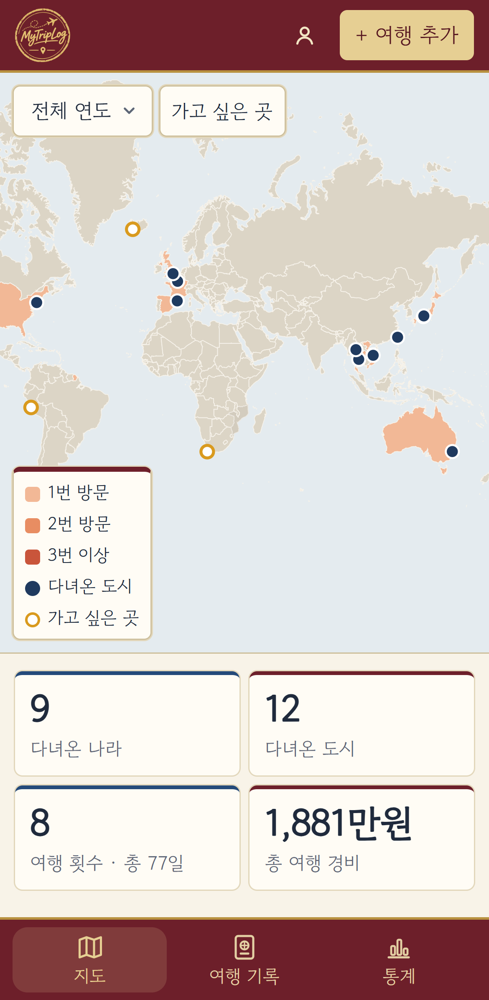
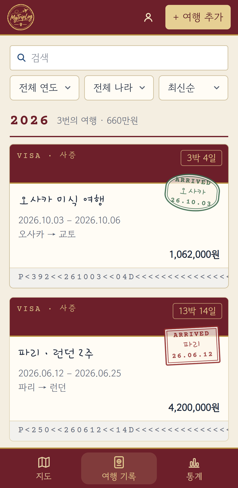
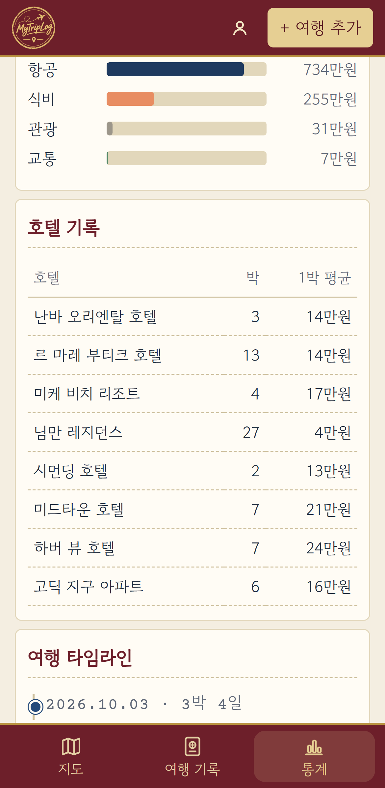
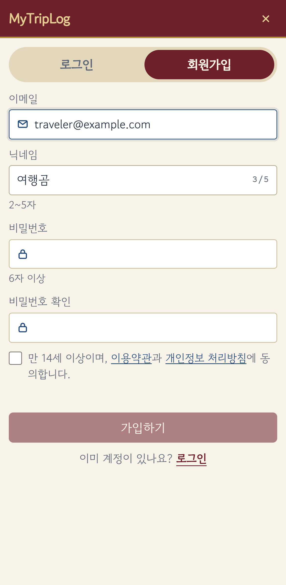
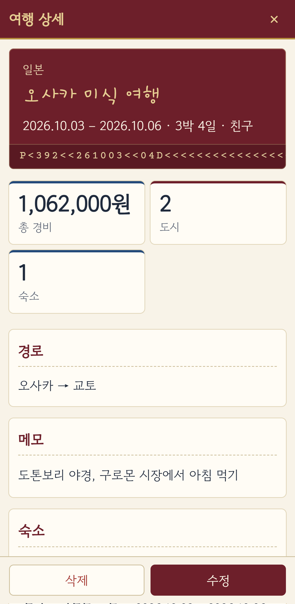
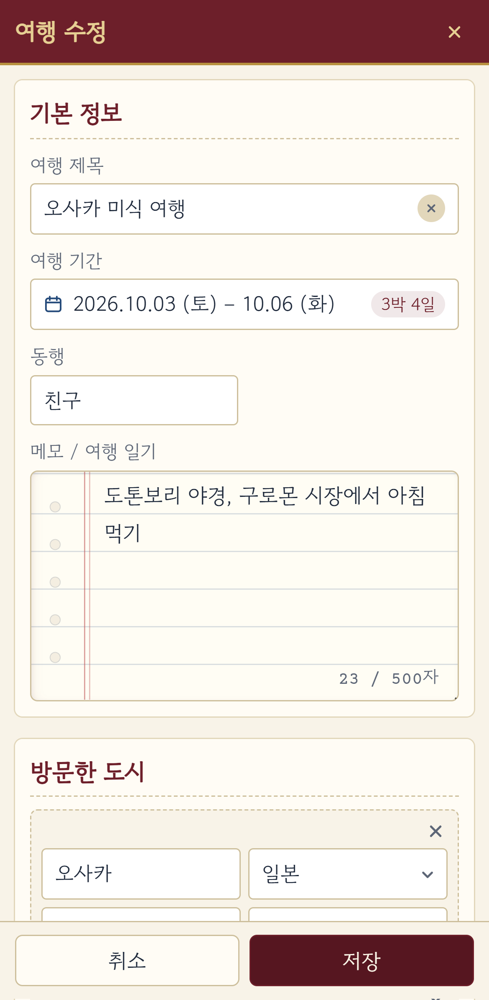

# MyTripLog · 나의 여행 지도

> 🧳 **토이 프로젝트**: 다녀온 나라와 도시, 숙소와 경비를 지도 위에 여권처럼 기록하는 개인 여행 다이어리

**배포 주소:** https://mytriplog-nu.vercel.app

<p>
  
  
  
  
</p>

## 소개

여행을 다녀와도 언제, 어디서, 얼마를 썼는지는 금방 잊어버립니다.
MyTripLog는 여행 한 번을 **사증(VISA) 카드 한 장**으로 남기고, 다녀온 나라는 **세계 지도에 색칠**해 보여 주는 웹 앱입니다.
여권, 입국 도장, MRZ(여권 아래쪽 기계 판독 줄)에서 디자인을 가져왔습니다.

## 주요 기능

| 화면 | 기능 |
| --- | --- |
| **지도** (`/`) | 방문 횟수에 따라 나라를 색칠하고, 다녀온 도시는 점으로, 가고 싶은 곳은 빈 원으로 표시합니다. 연도별로 걸러 볼 수 있고, 다녀온 나라·도시 수, 여행 횟수, 총 일수, 총 경비를 요약해 보여 줍니다. |
| **여행 기록** (`/trips`) | 여행을 연도별 사증 카드로 모아 보여 줍니다. 검색, 연도·나라 필터, 정렬을 지원합니다. |
| **여행 상세 / 수정** | 제목, 기간(달력에서 선택, N박 M일 자동 계산), 동행, 메모(여행 일기), 방문 도시(자동완성), 숙소, 항목별 경비를 기록합니다. |
| **통계** (`/stats`) | 항목별 경비(항공·식비·관광·교통 등), 숙소별 숙박 수와 1박 평균 가격, 여행 타임라인을 보여 줍니다. |
| **가고 싶은 곳** | 위시리스트 장소를 메모와 함께 지도에 표시합니다. |
| **계정** | 이메일 회원가입(인증 메일)·로그인, 닉네임, 비밀번호 재설정, 회원 탈퇴를 지원합니다. |
| **백업** | 모든 기록을 JSON으로 내보내고 다시 불러올 수 있습니다. |

<details>
<summary>화면 더 보기</summary>
<p>
  
  
  
</p>
</details>

## 기술 스택

- **Frontend:** React 19, TypeScript, Vite
- **지도:** D3 (`d3-geo`), TopoJSON (Natural Earth 1:50m 세계 지도)
- **Backend / 인증:** Supabase (Postgres + Auth, Row Level Security)
- **로컬 저장소:** IndexedDB (Supabase 설정이 없을 때)
- **배포:** Vercel (정적 호스팅, Cron, Analytics)

## 구조

```
src/
├─ components/      화면 컴포넌트 (지도, 여행 목록·상세·편집, 통계, 로그인 등)
│  └─ ui/           버튼, 모달, 달력, 셀렉트 같은 공용 UI
├─ store/           데이터 저장소
│  ├─ cloud.ts      Supabase 저장 (로그인 사용자)
│  └─ local.ts      IndexedDB 저장 (로컬 모드)
├─ lib/             지도 계산, 도시 데이터, 라우터, 포맷, 입력 글자 수 제한 등
└─ config.ts        환경 변수 읽기
api/keepalive.ts    Supabase 무료 프로젝트 일시정지를 막는 Vercel Cron 함수
supabase/schema.sql 테이블, RLS, 회원 탈퇴 함수 설정 SQL
public/data/        세계 지도 TopoJSON
```

**저장소 모드는 두 가지입니다.** `.env.local`에 Supabase 값이 있으면 로그인해서 클라우드에 저장하고, 없으면 이 브라우저의 IndexedDB에만 저장하는 로컬 모드로 동작합니다.

## 로컬에서 실행하기

```bash
npm install
npm run dev        # http://localhost:5173
```

Supabase 없이도 로컬 모드로 바로 써 볼 수 있습니다.

### Supabase 연결하기 (선택)

1. [Supabase](https://supabase.com)에서 프로젝트를 만듭니다.
2. **SQL Editor**에 [`supabase/schema.sql`](supabase/schema.sql) 전체를 붙여 넣고 실행합니다.
3. `.env.example`을 복사해 `.env.local`을 만들고 값을 채웁니다.

   ```env
   VITE_SUPABASE_URL=https://your-project-id.supabase.co
   VITE_SUPABASE_KEY=your-publishable-anon-key
   ```

   > publishable(anon) 키만 넣으세요. `service_role` / secret 키는 절대 넣으면 안 됩니다.

4. Authentication 설정(이메일 가입, 인증 메일, SMTP, Redirect URL)은 `schema.sql` 상단 주석을 참고하세요.

## 스크립트

| 명령 | 설명 |
| --- | --- |
| `npm run dev` | 개발 서버 실행 |
| `npm run typecheck` | 앱, 설정 파일, API 함수 타입 검사 |
| `npm run build` | 타입 검사 후 프로덕션 빌드 (`dist/`) |
| `npm run preview` | 빌드 결과 미리보기 |

## 배포 (Vercel)

- Vercel에 저장소를 연결하고 환경 변수 `VITE_SUPABASE_URL`, `VITE_SUPABASE_KEY`를 등록합니다.
- `vercel.json`이 다음을 설정합니다.
  - 모든 경로를 `index.html`로 보내서 `/trips`, `/stats`를 새로고침해도 404가 나지 않게 함
  - 매일 03:00(UTC)에 `/api/keepalive`를 호출해 Supabase 무료 프로젝트가 일시정지되지 않게 함
  - 지도 데이터(`/data/*`)를 오래 캐시함
